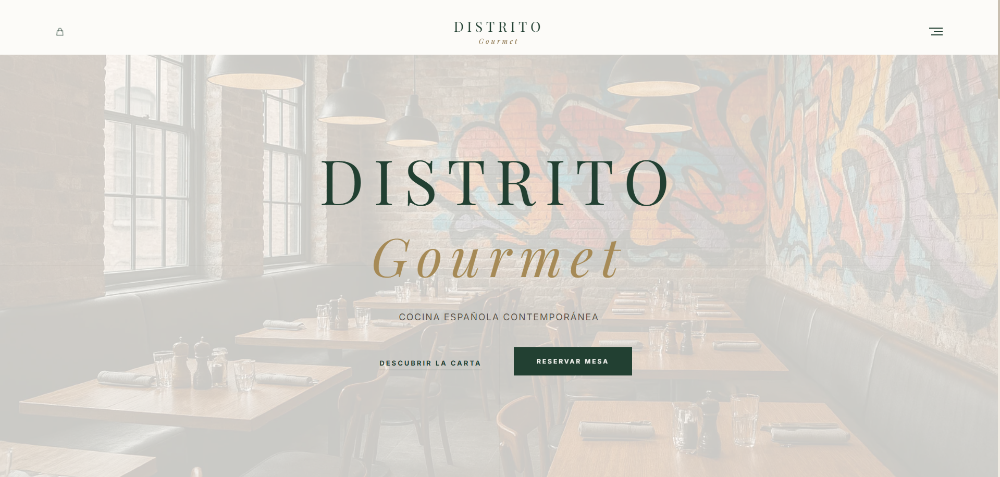

# ALEVICLOP

**Portfolio de Alex Vicente López · Full-Stack Developer**

Diseño y desarrollo experiencias web centradas en la claridad, el rendimiento y los detalles de interacción. Este repositorio contiene el código de mi portfolio personal: una aplicación bilingüe donde presento proyectos, decisiones técnicas, experiencia profesional y una faceta creativa vinculada a la fotografía.

**[Ver portfolio](https://www.aleviclop.dev)** · [Proyectos](https://www.aleviclop.dev/#proyectos) · [GitHub](https://github.com/AVL05) · [LinkedIn](https://www.linkedin.com/in/aleviclop/)



## Sobre el proyecto

ALEVICLOP no es únicamente una página de presentación: está diseñado para que cualquier visitante pueda comprender qué he construido, cuál fue mi aportación y cómo abordo los problemas de producto y desarrollo.

El contenido combina una identidad visual propia con casos de estudio, información profesional, navegación en español e inglés y una experiencia adaptable a escritorio y móvil.

### Funcionalidades principales

- **Portfolio bilingüe (ES/EN)** con rutas localizadas y preferencia de idioma persistente.
- **Casos de estudio** que ponen en contexto los proyectos, sus objetivos y las decisiones de implementación.
- **Interfaz responsive y accesible**, con navegación por teclado y respeto por `prefers-reduced-motion`.
- **Animaciones e interacciones** construidas con GSAP, sin depender del movimiento para acceder al contenido.
- **Contacto** con validación en servidor y medidas anti-spam.
- **SEO técnico** con metadatos localizados, canonical, sitemap, robots y datos estructurados.
- **Observabilidad** mediante Vercel Analytics y Speed Insights.
- **Verificación automatizada** con lint, comprobación de tipos, tests y pruebas E2E.

## Proyectos destacados

| Proyecto | Descripción | Caso de estudio |
| --- | --- | --- |
| **Distrito Gourmet** | Experiencia digital para un restaurante, con carta, pedidos, reservas y administración. | [Explorar](https://www.aleviclop.dev/proyectos/distrito-gourmet) |
| **LumaFlow Studio** | Software orientado a los flujos de trabajo de fotografía y creación audiovisual. | [Explorar](https://www.aleviclop.dev/proyectos/lumaflow-studio) |
| **raw.vives** | Galería y experiencia web de fotografía personal. | [Explorar](https://www.aleviclop.dev/proyectos/raw-vives) |

> Los casos de estudio describen los proyectos presentados en el portfolio; no todas sus aplicaciones se desarrollan dentro de este repositorio.

## Stack tecnológico

| Área | Tecnologías |
| --- | --- |
| Framework | Next.js 16 (App Router), React |
| Lenguaje | TypeScript |
| Estilos | Tailwind CSS 4, PostCSS |
| Animaciones | GSAP, ScrollTrigger |
| Componentes e iconografía | Radix UI, Lucide React, React Icons |
| Testing | Node.js Test Runner, Playwright |
| Calidad | ESLint, TypeScript |
| Plataforma | Vercel, GitHub Actions |

Las versiones exactas de las dependencias están registradas en `pnpm-lock.yaml`.

## Primeros pasos

### Requisitos

- **Node.js 22.x**
- **pnpm 10.34.1** (versión declarada en `package.json`)

### Instalación

```bash
git clone https://github.com/AVL05/Portfolio.git
cd Portfolio
corepack enable
pnpm install --frozen-lockfile
```

### Variables de entorno

Crea un archivo `.env.local` en la raíz y añade las variables necesarias:

```dotenv
NEXT_PUBLIC_SITE_URL=http://localhost:3100
WEB3FORMS_ACCESS_KEY=tu_clave_de_web3forms
```

| Variable | Propósito |
| --- | --- |
| `NEXT_PUBLIC_SITE_URL` | Origen utilizado para generar URLs y metadatos canónicos. |
| `WEB3FORMS_ACCESS_KEY` | Credencial privada para el envío de mensajes desde el servidor. |

La clave de Web3Forms **nunca** debe exponerse con el prefijo `NEXT_PUBLIC_` ni incorporarse a Git. Sin una clave válida, el formulario de contacto no podrá entregar mensajes mediante el proveedor.

### Desarrollo local

```bash
pnpm dev --hostname 127.0.0.1 --port 3100
```

Abre [localhost:3100](http://127.0.0.1:3100) para español o [localhost:3100/en](http://127.0.0.1:3100/en) para inglés.

Para ejecutar el servidor de desarrollo con Webpack en lugar de Turbopack:

```bash
pnpm dev:webpack
```

## Estructura del repositorio

```text
app/                  Rutas, layouts, APIs y metadatos
components/           Componentes y secciones de la interfaz
lib/                  Utilidades, internacionalización y SEO
lib/locales/          Contenido localizado en español e inglés
public/               Imágenes, iconos y recursos estáticos
tests/                Pruebas automatizadas
tests/e2e/            Pruebas de navegador con Playwright
docs/                 Documentación de diseño, auditorías y releases
.github/workflows/    Integración continua
```

La raíz contiene también `PRODUCT.md` (criterios de producto), `DESIGN.md` (dirección visual) y `AGENTS.md` (instrucciones de colaboración y agentes).

## Calidad y pruebas

```bash
pnpm lint
pnpm typecheck
pnpm test
pnpm build
pnpm exec playwright install chromium
pnpm test:e2e
```

| Comando | Objetivo |
| --- | --- |
| `pnpm lint` | Comprobar las reglas de ESLint. |
| `pnpm typecheck` | Verificar tipos sin generar archivos. |
| `pnpm test` | Ejecutar los tests basados en Node.js. |
| `pnpm test:e2e` | Validar flujos reales en un navegador. |
| `pnpm build` | Generar la compilación optimizada de producción. |
| `pnpm start` | Servir una compilación ya generada. |

La CI de GitHub Actions verifica el proyecto en las pull requests dirigidas a `main` y en los pushes a dicha rama. Las pruebas automatizadas complementan, pero no sustituyen, la revisión visual y las verificaciones en dispositivos reales.

## Internacionalización y SEO

La versión española utiliza la ruta raíz (`/`) y la inglesa `/en`. Los casos de estudio tienen rutas equivalentes en ambos idiomas.

El proyecto centraliza los textos en `lib/locales/`, el mapeo de rutas en `lib/i18n-paths.ts` y la configuración SEO en `lib/seo.ts`. También incorpora sitemap, robots, tarjetas sociales y datos estructurados para facilitar la indexación y compartir páginas.

## Despliegue

La aplicación está preparada para **Vercel**. La configuración del proyecto está en `vercel.json`, mientras que las cabeceras de seguridad y otras opciones de Next.js se mantienen en `next.config.mjs`.

**Importante:** fusionar cambios en `main` no implica necesariamente publicarlos. La política documentada del proyecto requiere validar la versión y realizar el despliegue a producción de forma explícita. Consulta [la documentación de release](docs/RELEASE_2_1.md) antes de publicar o modificar el proceso de despliegue.

## Documentación adicional

- [PRODUCT.md](PRODUCT.md) — propósito del producto, contenido y criterios editoriales.
- [DESIGN.md](DESIGN.md) — identidad visual y sistema de diseño.
- [docs/EXPERIENCE_REDESIGN.md](docs/EXPERIENCE_REDESIGN.md) — decisiones de experiencia y rediseño.
- [docs/M4_FINAL_AUDIT.md](docs/M4_FINAL_AUDIT.md) — auditoría técnica histórica.
- [docs/RELEASE_CANDIDATE.md](docs/RELEASE_CANDIDATE.md) — validaciones y preparación para release.

Los informes históricos se conservan como referencia y **no representan necesariamente las métricas o el estado de la versión actual**.

## Autor y contacto

**Alex Vicente López** — Desarrollador Full-Stack, Valencia (España).

[Portfolio](https://www.aleviclop.dev) · [LinkedIn](https://www.linkedin.com/in/aleviclop/) · [GitHub](https://github.com/AVL05) · [Email](mailto:alexviclop@gmail.com)

## Licencia

**Todos los derechos reservados.** El código, diseño y contenido del repositorio no se ofrecen como plantilla de libre reutilización. Consulta [LICENSE.md](LICENSE.md) para conocer las condiciones aplicables.
